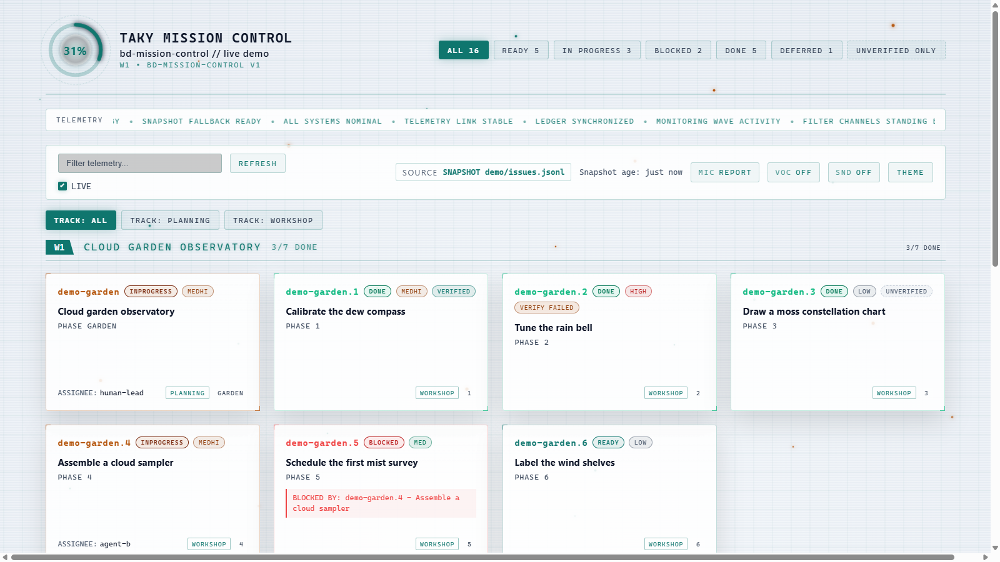

# bd-mission-control

`bd-mission-control` is a single-file mission control panel for Beads (`bd`): drop one HTML file into a project, point it at `issues.jsonl`, and get a live HUD for waves, blockers, verification drift, and orchestration telemetry. See the [live demo](https://maisdesign.github.io/bd-mission-control/) and the screenshot placeholder below.



The live demo uses fictional issues from [`demo/issues.jsonl`](demo/issues.jsonl). Regenerate it with `node scripts/build-demo.mjs`; the build does not read the project's tracker or call `bd`.

## Quickstart

The panel auto-loads two optional sibling files when they exist:

- `orchestration.config.js`
- `orchestration-data.js`

Those files are loaded before the inline panel runtime. In a wired project, the panel then tries to fetch `../.beads/issues.jsonl` by default. When that fetch fails, it falls back to `window.BMC_SNAPSHOT` from `orchestration-data.js`. If neither is available, it shows the built-in demo dataset.

### Path A: vendor one file, add a tiny config, optionally generate a snapshot

PowerShell:

```powershell
iwr https://raw.githubusercontent.com/maisdesign/bd-mission-control/main/dist/orchestration.html -OutFile docs/orchestration.html
@'
window.BMC_CONFIG = {
  title: "your-project mission control",
  dataPath: "../.beads/issues.jsonl"
};
'@ | Set-Content -Encoding utf8 docs/orchestration.config.js
```

POSIX shell:

```sh
curl -fsSL https://raw.githubusercontent.com/maisdesign/bd-mission-control/main/dist/orchestration.html -o docs/orchestration.html
cat > docs/orchestration.config.js <<'EOF'
window.BMC_CONFIG = {
  title: "your-project mission control",
  dataPath: "../.beads/issues.jsonl"
};
EOF
```

If you plan to open the panel via `file://`, generate a sibling snapshot first:

```powershell
powershell -NoProfile -File scripts/refresh.ps1 -Out docs/orchestration-data.js
```

```sh
sh scripts/refresh.sh --out docs/orchestration-data.js
```

### Path B: clone and let the install scripts wire it

```powershell
git clone https://github.com/maisdesign/bd-mission-control.git
powershell -NoProfile -File bd-mission-control/scripts/install.ps1 -Target C:\path\to\your-project
```

```sh
git clone https://github.com/maisdesign/bd-mission-control.git
sh bd-mission-control/scripts/install.sh -Target /path/to/your-project
```

Real install behavior, verified against `scripts/install.ps1` and `scripts/install.sh`:

- `-Target` is required.
- `-Dir` changes the vendored panel subdirectory and defaults to `docs`.
- `-Update` replaces `orchestration.html`, `scripts/refresh.ps1`, and `scripts/refresh.sh`.
- `-Force` also replaces locally modified vendored files, with a loud warning.
- `orchestration.config.js` is created only if missing and preserved on reruns.
- `orchestration.meta.json` is optional and left untouched if you create one.

## Data Flow

The runtime follows one honest chain:

1. Live mode: fetch `BMC_CONFIG.dataPath`, default `../.beads/issues.jsonl`.
2. Snapshot mode: if live fetch fails and `window.BMC_SNAPSHOT` exists, read `orchestration-data.js`.
3. Demo mode: if neither source is available, show the built-in sample issues.

That means:

- Over HTTP, the default experience is live fetch from `../.beads/issues.jsonl`.
- Over `file://`, browsers usually block fetches to sibling files, so blank/live-less panels are expected unless you first run a refresh script.
- `scripts/refresh.ps1` and `scripts/refresh.sh` generate `orchestration-data.js`, which makes the same vendored panel usable from `file://`.

Refresh behavior, verified against both scripts:

- PowerShell args: `-BeadsDir`, `-Out`, `-NoBdEnrich`
- POSIX args: `--beads-dir`, `--out`, `--no-bd-enrich`
- Default output is `./orchestration-data.js`
- By default, refresh tries to enrich the snapshot with selected `bd remember` telemetry; `--no-bd-enrich` or `-NoBdEnrich` disables that

## Live updates with bd events (optional, bd >= 1.3.0)

With Node 24 and bd >= 1.3.0, the optional [follow helper](scripts/follow.mjs) keeps `.beads/issues.jsonl` current after local issue changes. Enable the journal in the workspace first: `bd config set events-journal true`. This setting affects every bd command in that workspace, not just the helper.

```sh
node scripts/follow.mjs --beads-dir /path/to/project/.beads --checkpoint /path/to/project/follow.checkpoint.json
```

Use `--bd /path/to/bd` to select a real executable (default: `bd` on PATH). On Windows, select `bd.exe`; npm `bd.cmd` shims cannot run because the helper spawns without a shell. Use `--debounce-ms 300` to tune batching; a max wait of 10 times the debounce (capped at 2147483647 ms) starts an export even while events keep arriving. Exports are serialized: events received during an export wait for that export to finish. Use `--out /path/to/project/docs/orchestration-data.js` to regenerate the `file://` snapshot after each export. Snapshot generation uses the sibling refresh script with memory enrichment disabled; Windows requires `pwsh`, elsewhere POSIX `sh`.

Without a checkpoint, the helper exports all issues (excluding memories) and starts following the journal head. The checkpoint stores the last successfully exported sequence atomically, so restarting with the same file replays missed changes. Retention gaps, corrupt checkpoints, and checkpoints above the current head trigger a full rebuild. A corrupt checkpoint logs `bmc-follow: rebuild reason=corrupt-checkpoint`; filesystem access failures still exit 1. Run one helper per checkpoint/output pair; automatic lock enforcement is a follow-up.

To stop cleanly, press Ctrl-C in the helper's console. SIGTERM also stops it on POSIX, but SIGTERM does not reach Node on Windows. Programmatic parents on either platform can launch with `--stop-on-stdin-eof` and piped stdin, then close that pipe (for a Node child, `child.stdin.end()`). With this flag, TTY stdin is rejected at startup with a clear message and exit 1. Stdin errors are logged and stop the helper like EOF. When launched with a Node IPC channel (`stdio` includes `'ipc'`), send `child.send({ type: 'stop' })` or call `child.disconnect()`. Shutdown stops tailing immediately and gives an in-flight export/refresh two seconds to finish. It then terminates remaining children, escalates after one second, and abandons inherited pipes with a diagnostic after 1.5 seconds. Writers use private staging directories beside the outputs. Cleanup retries temporary locks and logs persistent failures without changing the shutdown exit code. At startup, the helper removes `.bmc-follow-*` directories older than ten minutes only beside the export target and `--out`, logging each removal; recent directories, files and symlinks are left alone. Output and checkpoint replacement share bounded retries for Windows sharing violations. A forced writer stop preserves the checkpoint for replay. Register exit and stream listeners before requesting a stop, then wait for the helper's `exit`, each piped stream's `close`, and IPC `disconnect` before removing its workspace. Node 24.18 can omit the aggregate child `close` event after a parent calls `child.disconnect()`, even when the process and streams have closed. Forcibly killing only the helper on Windows can orphan its bd child.

The helper sets `BD_DISABLE_EVENT_FLUSH=1` only for its bd children: bd 1.3.0 otherwise starts a detached `send-metrics` process that inherits the workspace directory and can keep it locked on Windows after bd exits. This does not change saved metrics settings or disable collection: [bd's collection enablement](https://github.com/gastownhall/beads/blob/v1.3.0/cmd/bd/main.go) uses `BD_DISABLE_METRICS`, `DO_NOT_TRACK`, and the saved user preference. The real-bd tests additionally set `BD_DISABLE_METRICS=1` for their child processes, verify workspace processes (including descendants of completed test commands on Windows and helper process groups/cwd on POSIX), and share a nine-second teardown deadline with bounded linear removal retries. If stopping exhausts that deadline, one final process query gets up to one second to report leftover PIDs. Persistent locks or surviving processes fail the tests with diagnostics.

After `bd dolt pull`, switching clone/replica, or changing the bd branch, stop the helper, delete its checkpoint, and restart. Sync and merge changes are not journaled, and sequence numbers are local to each replica; an overlapping sequence cannot identify a different clone. Keep checkpoints local to their workspace. The panel's existing HTTP polling and `file://` reload behavior still apply.

## Config

`window.BMC_CONFIG` is intentionally small. These are the only keys read by `src/panel.js`.

| Key | Type | Default | What it does |
| --- | --- | --- | --- |
| `title` | string | `""` | Replaces the document title and the i18n `title` string when provided |
| `accent` | string | `""` | Sets the `--bmc-accent` CSS variable; hex colors are also expanded into `--bmc-accent-rgb` |
| `dataPath` | string | `"../.beads/issues.jsonl"` | Live JSONL fetch path |
| `refreshInterval` | number | `15000` | Auto-refresh interval in milliseconds, only used in live mode |
| `strings` | object | `{}` | String overrides merged into the built-in UI copy |
| `metaPath` | string | `""` | Optional JSON overlay path fetched after config load |

Example:

```js
window.BMC_CONFIG = {
  title: "acme mission control",
  accent: "#19d3da",
  dataPath: "../.beads/issues.jsonl",
  refreshInterval: 10000,
  strings: {
    title: "ACME MISSION CONTROL",
    footer_text: "Demo data: real bead tracker"
  },
  metaPath: "./orchestration.meta.json"
};
```

## BMC_CONFIG Strings

The runtime deep-merges `BMC_CONFIG.strings` into the shipped UI copy. Common keys include `title`, `search_placeholder`, `refresh`, `auto`, `theme`, `filter_all`, `filter_ready`, `filter_inprogress`, `filter_blocked`, `filter_done`, `filter_deferred`, `card_assignee`, `card_blocked_by`, and `footer_text`.

## Meta Overlay

`orchestration.meta.json` is optional. The panel can also consume inline `window.BMC_META_JSON` or `window.BMC_META`, but for normal vendoring the file-based overlay is the practical path.

Philosophy: curation enriches, never required.

```json
{
  "waves": {
    "4": {
      "title": "Wave 4",
      "subtitle": "Docs, QA, release"
    }
  },
  "beads": {
    "demo-9": {
      "label": "Observatory visitor guide",
      "phase": "docs",
      "track": "DOCS",
      "note": "Include the evening telescope schedule"
    },
    "demo-10": {
      "flag": true,
      "note": "Opening night depends on the visitor guide"
    }
  }
}
```

Extended examples and field notes live in [docs/meta-json-overlay.md](docs/meta-json-overlay.md).

## Verification Ledger

The panel surfaces the verification distinction on purpose:

- closed is workflow state
- verified is independent evidence

In practice, the runtime expects verification evidence from issue comments such as `VERIFIED bead=<id> result=pass ...`. A closed bead without an independent pass comment is still shown as unverified drift, because "done" and "checked by another operator" are different facts.

This fits multi-agent or multi-reviewer workflows without baking in any machine-specific paths. The reference note is in [docs/verification-ledger.md](docs/verification-ledger.md).

## Requirements

- Any Beads workflow that exports `.beads/issues.jsonl`
- A static file host or local HTTP server for live mode
- Node only if you are developing/rebuilding the panel or running the optional follow helper, not if you are just vendoring `dist/orchestration.html`

## Compatibility

- PowerShell `5.1+`
- POSIX `sh`
- Static hosting, GitHub Pages, and local HTTP servers
- `file://` only when you provide a generated snapshot

## FAQ

### Why is the panel blank or stuck on demo under `file://`?

Because browsers usually block `fetch()` for local sibling files. Run one of the refresh scripts to generate `orchestration-data.js`, then reopen the same HTML file.

### Why does live mode fail even over HTTP?

The panel fetches `dataPath` directly. If your host blocks `../.beads/issues.jsonl` with CORS, auth, or static-server rules, live mode will fail and the runtime will fall back to snapshot or demo.

### Does this require a specific `bd` version?

No special release contract is hardcoded here. If your workflow exports `.beads/issues.jsonl`, the panel can read it. The refresh scripts optionally call `bd memories` and `bd recall` only for enrichment telemetry.

### What exactly gets auto-loaded next to the panel?

The shipped panel includes sibling script tags for `orchestration.config.js` and `orchestration-data.js`. Missing files are tolerated; present files are evaluated before panel init.

## Contributing

Zero-dependency policy is law. Keep it browser-native, Node-native, and auditable. If documentation claims a flag, key, or file contract, verify it against the code before merging.

## License

[PolyForm Shield 1.0.0](https://polyformproject.org/licenses/shield/1.0.0) — free to use, modify, and distribute for virtually any purpose, *except* building or running a product that competes with this project or with the licensor's own offerings. See [LICENSE](LICENSE) for the full terms.

If this is useful to you, a mention or link back is appreciated but never required.

## Italiano

`bd-mission-control` e un pannello HTML singolo per osservare tracker Beads in tempo reale o da snapshot.
Funziona bene servito via HTTP, dove prova a leggere `../.beads/issues.jsonl` in live mode.
Se apri il file con `file://`, genera prima `orchestration-data.js` con `scripts/refresh.ps1` o `scripts/refresh.sh`.
Gli script di installazione copiano il pannello e i refresh script, ma preservano `orchestration.config.js` gia esistente.
Demo pubblica: [maisdesign.github.io/bd-mission-control](https://maisdesign.github.io/bd-mission-control/).

**Licenza:** [PolyForm Shield 1.0.0](https://polyformproject.org/licenses/shield/1.0.0) — vedi [LICENSE](LICENSE).
